# System Architecture

This document describes the deployed application structure and the data model defined in `backend-express/prisma/schema.prisma`. The backend is a Bun-hosted Express and TypeScript API, the frontend is a React application built with Vite, and PostgreSQL is accessed through Prisma 7.

## System context

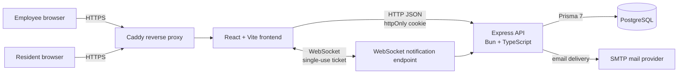

In the Compose deployment, Caddy is the public entry point; it serves the frontend and routes application traffic within the Docker network. The frontend sends API requests with browser credentials enabled. API CORS is configured from `CORS_ORIGINS`. The HTTP server also upgrades `/ws/notifications` requests to authenticated WebSocket connections.

## Application components

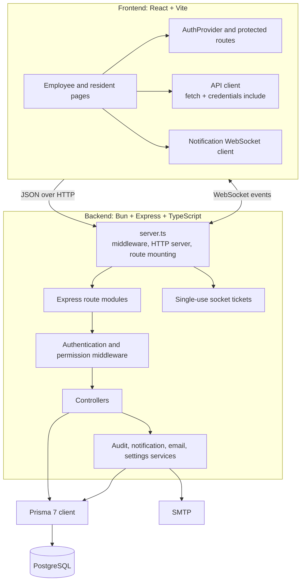

The API mounts routers under `/api`: auth, employees, roles, sites, permissions, locations, rooms, beds, notifications, audit logs, room allocations, residents, bookings, dashboard, and email logs. Authentication and authorization middleware protect routes according to account type and permissions. The frontend applies matching route guards for employee pages. The schema also contains complaint and rating data models.

## Use cases

The use cases below describe the domain supported by the application and data model. An employee's available actions depend on their assigned roles and permissions. Resident-facing use is represented by the resident account and booking data; the mounted frontend routes are employee-focused.

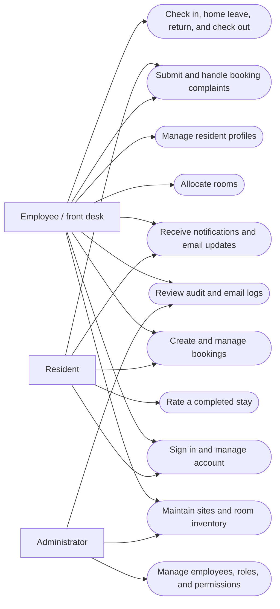

## Data flow diagrams

### Level 0: system context

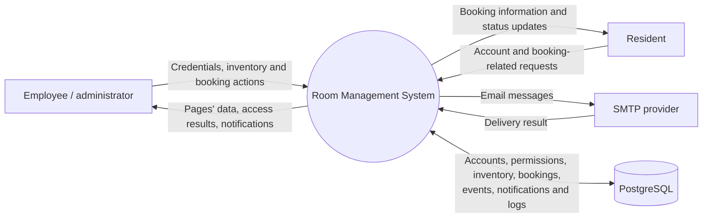

### Level 1: request, persistence, and notification flow

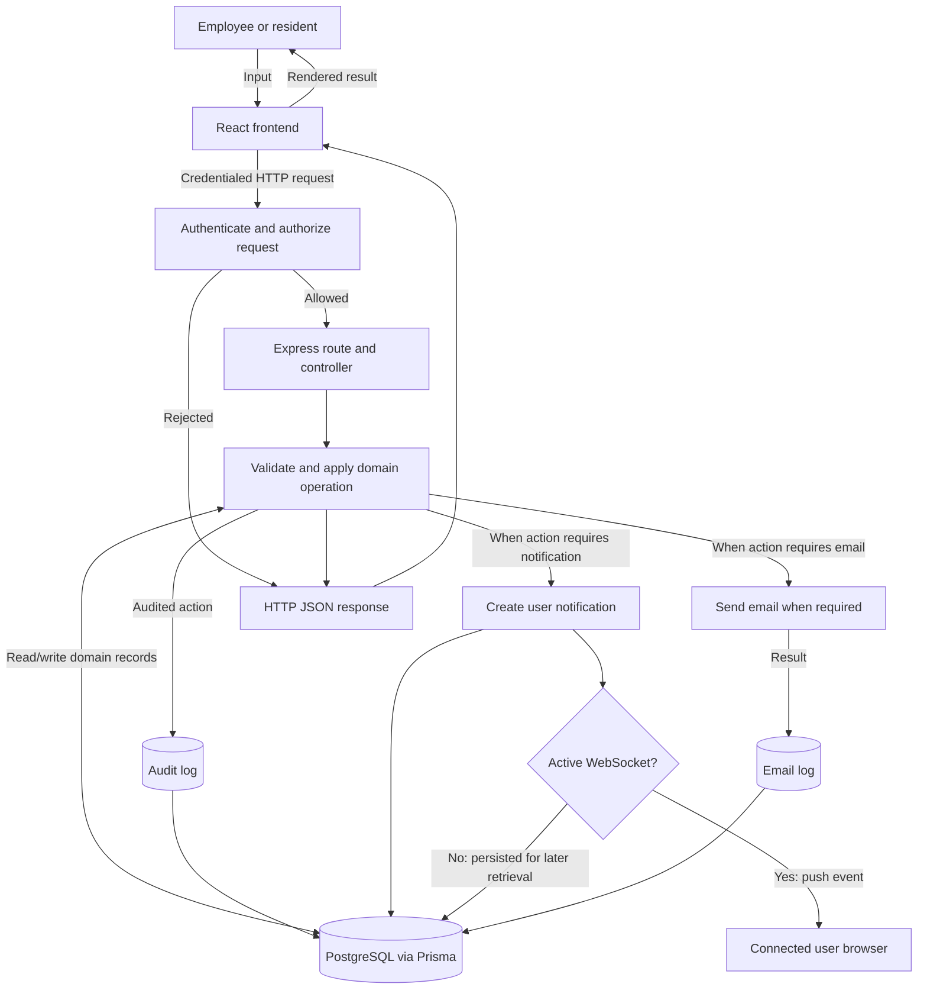

## Main business flows

### Room inventory setup

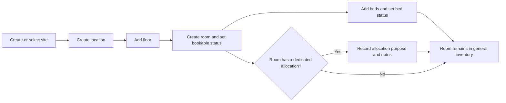

The hierarchy is persisted as `Site → Location → Floor → Room → Bed`. A room can have at most one `RoomAllocation`; bed status is represented by `VACANT`, `BOOKED`, `OCCUPIED`, or `HOME_LEAVE`.

### Booking and stay lifecycle

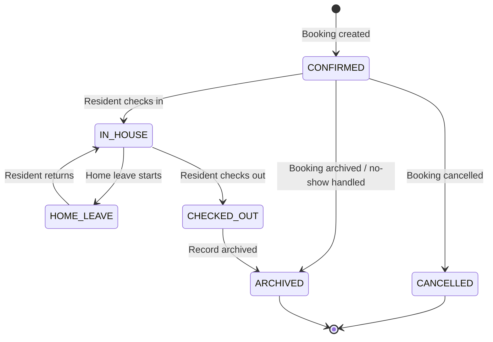

Each booking links a resident to a bed and stores the planned start/end dates, current status, and applicable lifecycle timestamps. Home leave is tracked in a separate `HomeLeave` record, while `BookingEvent` records actions and their actor. The bed's availability/status must remain consistent with the booking lifecycle; exact transitions are enforced by booking endpoints.

A resident cannot hold overlapping active bookings. Booking creation, updates, and extensions reject any date range that overlaps the resident's existing `CONFIRMED`, `IN_HOUSE`, or `HOME_LEAVE` bookings, preventing double-booking across beds.

Authorized staff can move confirmed and in-house bookings from the calendar by changing the bed, date range, or both. The update endpoint validates bed access and rejects overlapping active bookings; the calendar asks for confirmation before submitting the move.

The Front Desk views support a start-to-end date range filter. Arrival and departure use the booking start/end dates, near-end uses the booking end date, home leave uses the leave start date, and historical ranges use stay-overlap rules so records active during the range remain visible. The selected range is applied consistently to tab counts and Excel exports; only the current range exposes row actions.

### Complaint and stay feedback

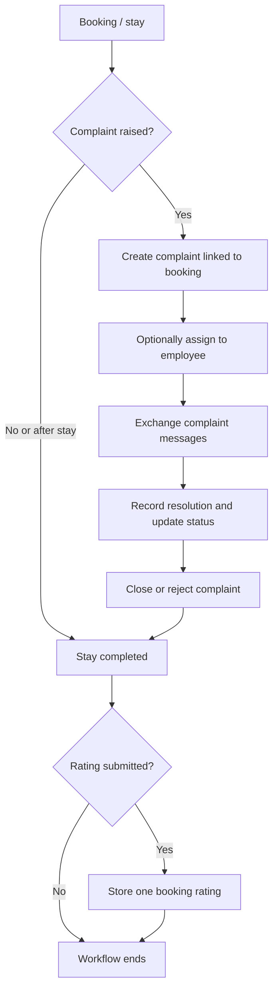

The schema supports complaints, assignment, message threads, resolution details, and one rating per booking. Complaint and rating route modules exist in the repository but are not mounted in `server.ts` at the time of writing; the data model therefore does not by itself imply that these flows are reachable through the running API.

## Request and data flows

### Authenticated API request

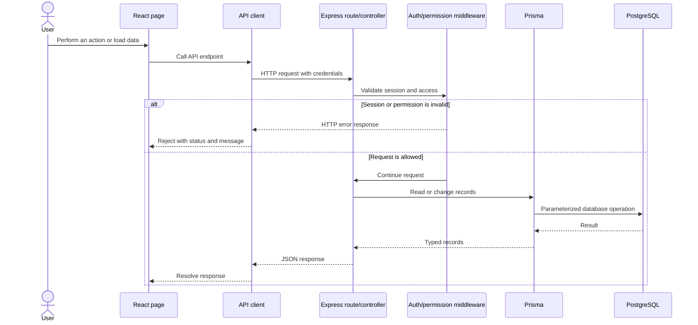

### Booking lifecycle and side effects

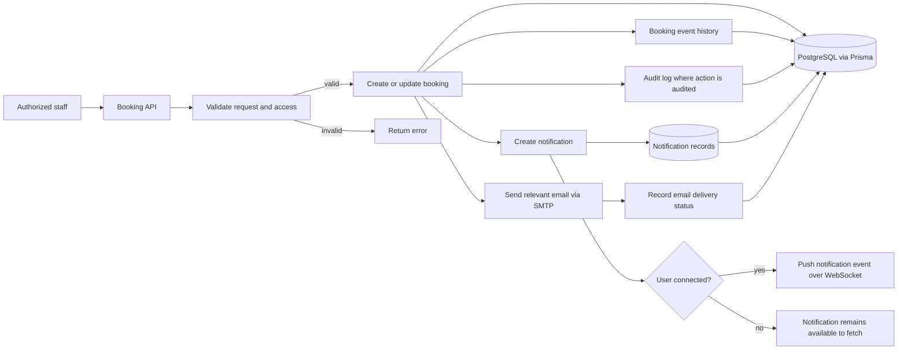

Booking records connect residents to beds and preserve lifecycle timestamps and status. Home-leave records and booking events capture related lifecycle information. Email, notification, and audit records provide operational history. Specific side effects depend on the endpoint and action.

### Notification connection

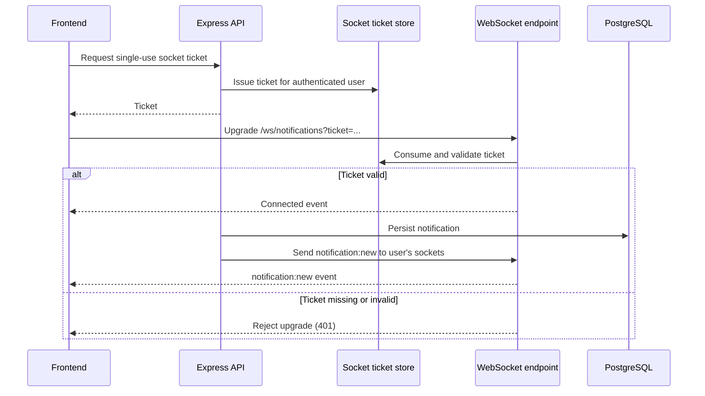

PostgreSQL is the durable source for notifications. If a user has no active socket connection, the notification service does not push it; the user can retrieve it later through the notification API.

## Entity relationship diagram

The ERD follows Prisma relations. `||--o{` denotes one-to-many, `||--o|` one-to-zero-or-one, and `}o--o{` denotes many-to-many through the named join entity. Fields shown are identifiers and relationship keys, with selected domain fields for readability.

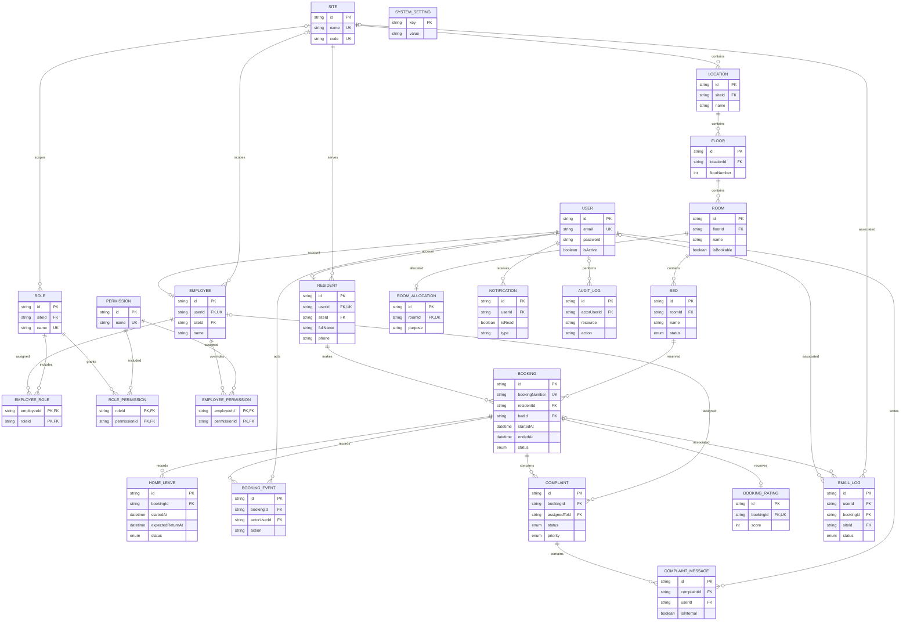

## Data ownership and key relationships

- A `User` is an authentication account and may be linked one-to-one to an `Employee` or `Resident` profile. Users also own notifications and may be referenced as actors, authors, or email recipients.
- Employees can belong to a site and receive roles and direct permissions. Roles can be site-scoped and grant permissions. The two join models allow multiple roles/permissions per employee.
- The physical hierarchy is `Site → Location → Floor → Room → Bed`. Rooms may have one optional `RoomAllocation`; each bed can have multiple booking records over time.
- A booking belongs to one resident and one bed. It can have home leaves, lifecycle events, complaints, email records, and at most one rating. Complaint threads contain messages and may be assigned to an employee.
- `AuditLog`, `Notification`, and `EmailLog` store operational records. `SystemSetting` stores application settings as key/value entries and has no foreign-key relation.

## Runtime and deployment

`backend-express/src/server.ts` creates the Express app and HTTP server, registers JSON and cookie parsing plus credentialed CORS, mounts API routers, and initializes the notification WebSocket handler. The API defaults to port `5000`. Prisma connects to PostgreSQL using `DATABASE_URL`; SMTP configuration is supplied through environment variables.

The Compose stack defines Caddy, frontend, backend, and PostgreSQL services on a private bridge network. PostgreSQL data is persisted in a named volume. Caddy and frontend are exposed to clients; backend and database are internal services. The frontend can use `VITE_API_BASE_URL`; when unset it uses same-origin requests in production and `http://localhost:5000` in development.
